# 🏴‍☠️ Tortugarr

Tortugarr is a specialized, couch-locked automation extension fork of the [Moonfin-Core](https://github.com/Moonfin-Client/Moonfin-Core) framework (built on commit `567e2a8c`). 

While the core media playback, multi-server unification, and design engine are powered by Moonfin and its contributors, Tortugarr adds a dedicated automated server orchestration installer, localized junk-release filtering, and single-click remote download routing directly from the TV layout.
<p align="center">
  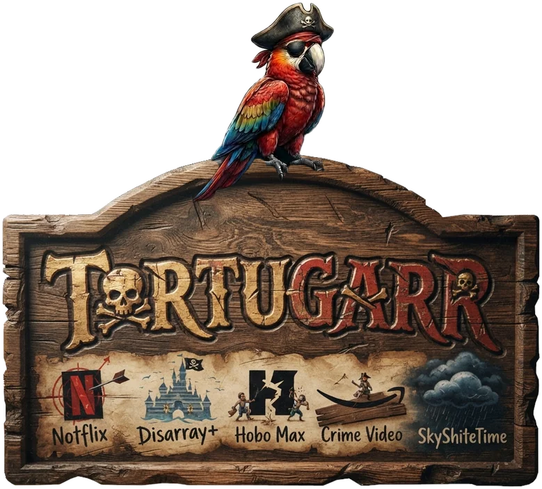
</p>

<h1 align="center">Every pirate needs a harbor.</h1>

<p align="center">
  <b>Your own streaming service. On your TV. Yours forever.</b><br>
  Tired of five subscriptions, rising prices and shows that vanish when a licence runs out, we built our own streaming service at home: an app for Android TV and phones, and a one-command server installer. Pick the exact file from the sofa, keep it forever. No subscriptions, no ads.
</p>

<p align="center">
  
</p>

---

## 📺 Five subscriptions, and still nothing to watch?

Shows vanish. Prices go up. The film you wanted is suddenly "not available in your region". 

**Tortugarr turns a spare PC into your own streaming service.** It looks and feels like the big commercial apps, it runs natively on your TV with your normal remote, and everything you add stays in your library forever.

## 🛋️ From the sofa, in three clicks

1. **Browse** what is trending, popular and coming soon, right on the TV screen.
2. **Pick** *Download Now*, and choose the exact file release: quality, size, and how many seeders share it.
3. **Watch.** It lands in your library completely on its own, with matching subtitles.

No laptop needed. No copying files around on USB sticks. No fiddling with five different web management pages.

<p align="center">
  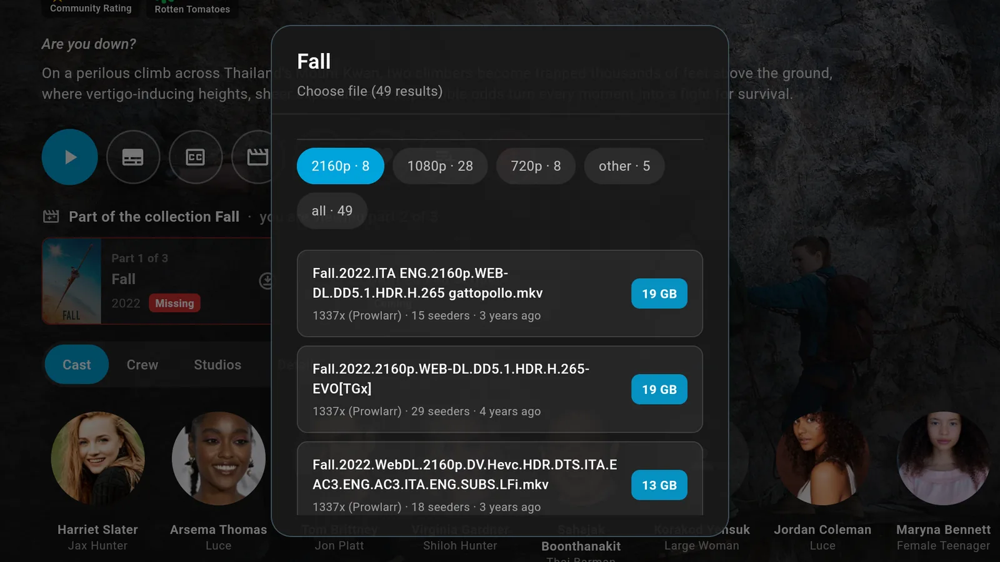<br>
  <sub><b>Download Now</b>: every release, sorted by quality, with size and seeders. You pick; it does the rest.</sub>
</p>

## 🚀 Why people keep it

- 🛋️ **Made for the remote:** Every single feature works from the sofa, optimized for Android TV and Google TV d-pads.
- 🎯 **You choose the file:** No black box automation: see every available release, its quality, health, and size, and pick the one you want.
- 🛡️ **Fakes stay out:** Cinema cam rips, fake releases and hidden `.exe`/`.scr` files are automatically filtered and blocked before they reach your hard drive.
- 📺 **Series that complete themselves:** See exactly which episodes you are missing from a season. Grab one, a whole season, or track it automatically as new episodes air.
- 💬 **Subtitles included:** Fetched automatically by your server. Missing one? Search and attach it straight from the TV layout.
- 🧹 **Cleans up after itself:** Delete a title directly from the TV UI. The media file, the torrent download, and the server request all disappear cleanly. Running low on space? It tells you what is safe to remove.
- 🔒 **Nothing phones home:** The app talks directly to your server and nothing else. No account with us, no tracking. The APK itself holds zero sensitive API keys.
- 📱 **TV, phone and tablet:** Access the exact same library everywhere. Start watching on your phone while traveling, finish on the TV when you get home.

<p align="center">
  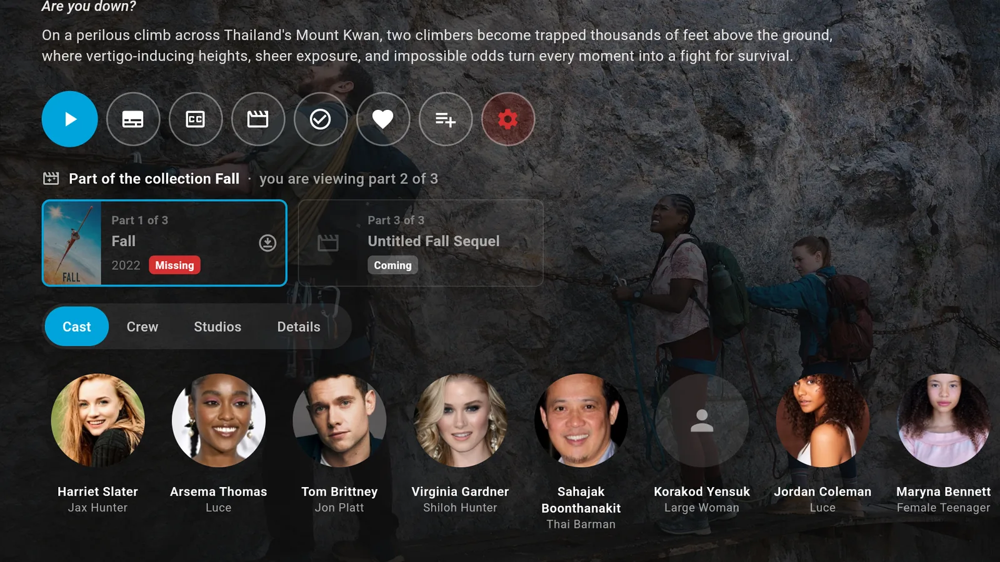<br>
  <sub>Film series at a glance: the parts you have, the ones you are <b>missing</b> (one click to get them), and what is <b>coming</b>.</sub>
</p>

<p align="center">
  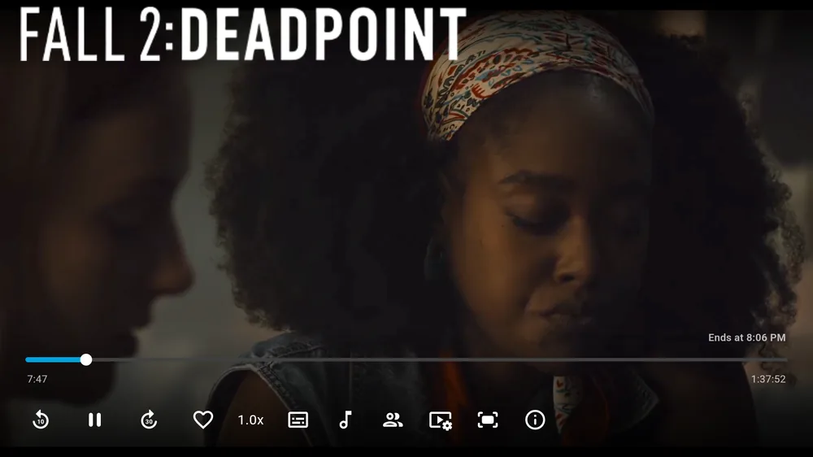
  &nbsp;
  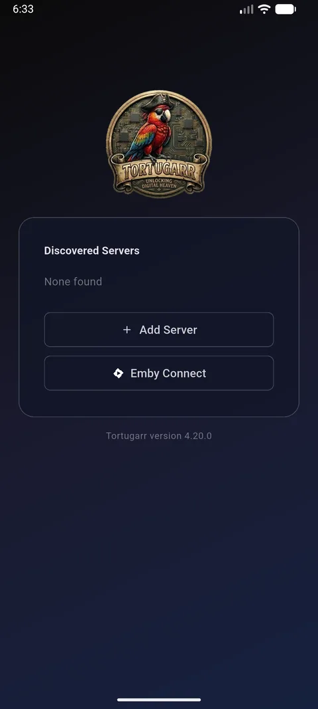
</p>

---

## 🎬 See it in action

<p align="center">
  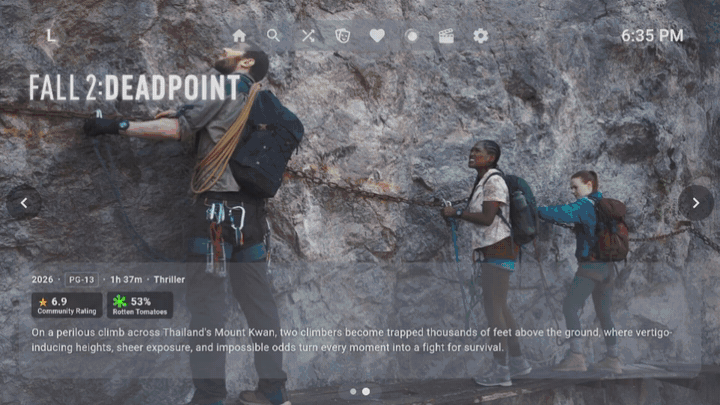<br>
  <sub>Browse with the remote: open a film and see the whole film series – what you have, what is <b>missing</b>, what is <b>coming</b>.</sub>
</p>

<p align="center">
  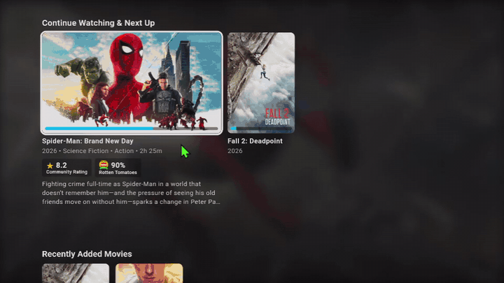<br>
  <sub>Delete from the sofa. It asks first, then the file, the download and the request are gone.</sub>
</p>

▶️ Full videos: [TV app, 48 s](https://github.com/tortugarr/tortugarr/raw/main/docs/media/tv-demo.mp4) · [Installing, 1:26 sped up](https://github.com/tortugarr/tortugarr/raw/main/docs/media/install-timelapse.mp4) · [Uninstalling, 42 s](https://github.com/tortugarr/tortugarr/raw/main/docs/media/uninstall.mp4)

<details>
<summary><b>More screenshots</b></summary>
<br>
<p align="center">
  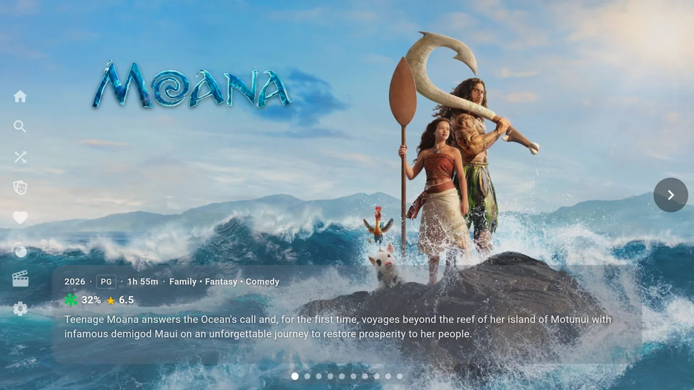
  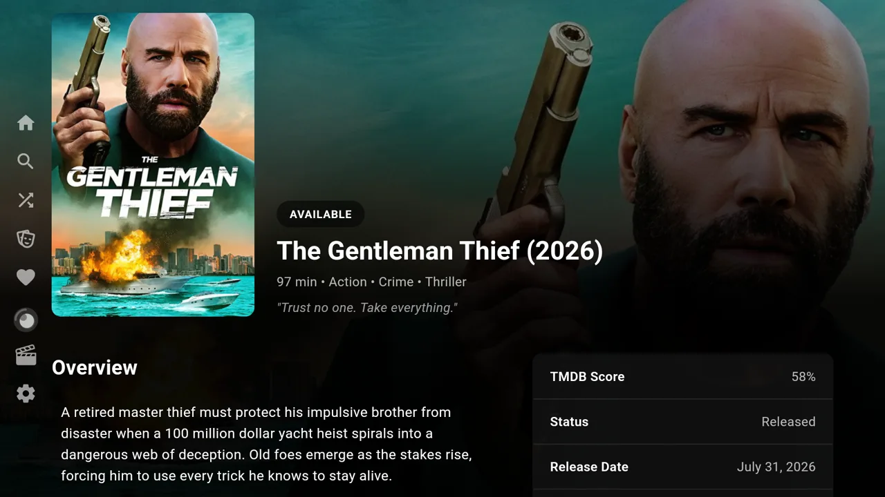
  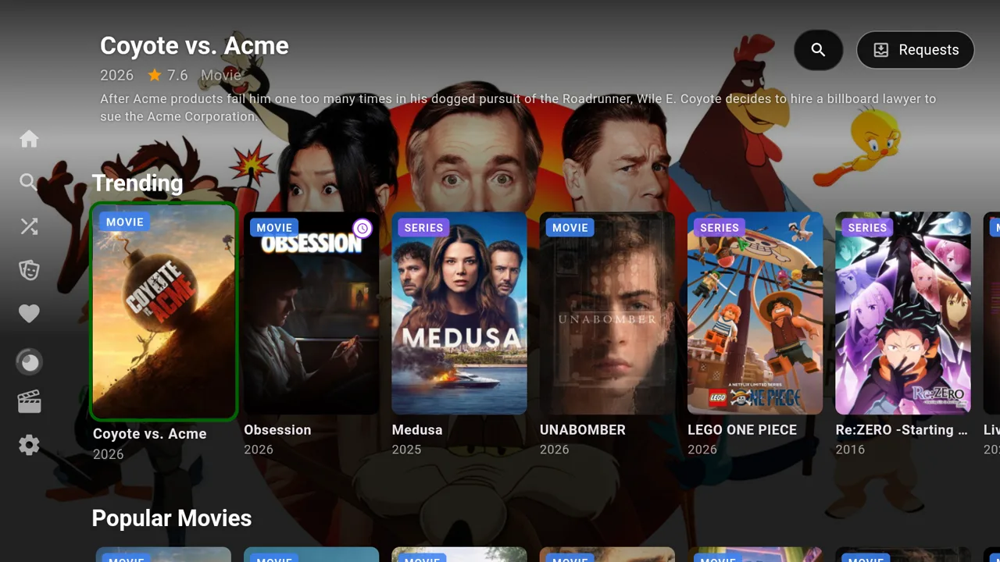
  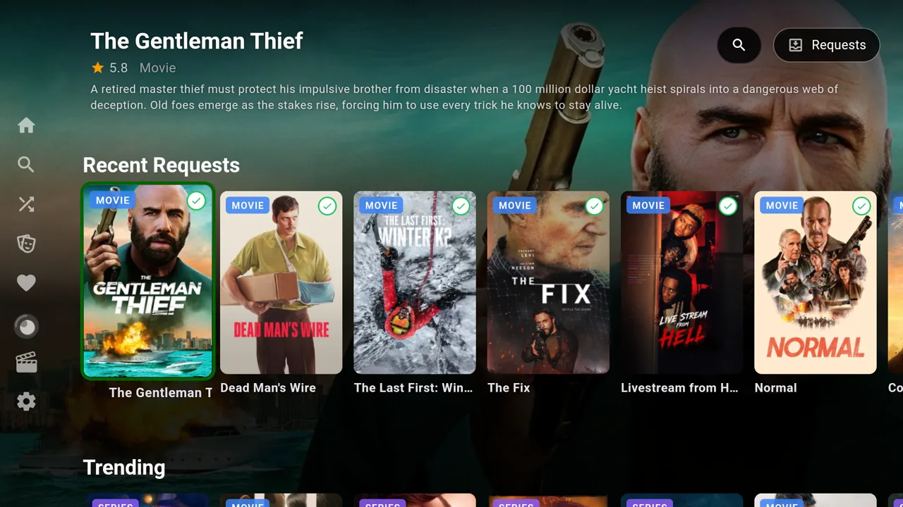
</p>
</details>

## ⚙️ How it works

One command sets up the whole harbor. A few questions with sensible defaults, then the installer sets up and connects everything: Jellyfin, Seerr, Sonarr, Radarr, Prowlarr, Bazarr, the download client and the Tortugarr plugin. The app talks to your Jellyfin server; downloads, deletes and subtitles go through the Tortugarr plugin there, so the app holds no keys.

Tortugarr does not bundle these tools. They are independent open-source projects; the installer downloads their official releases and wires them together.

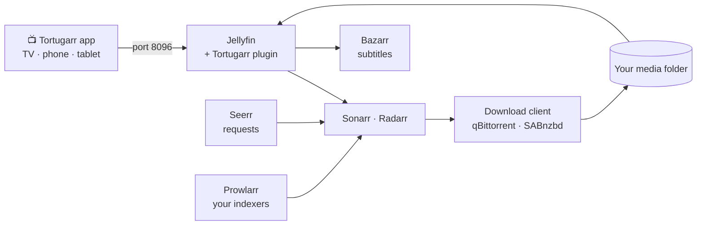

Ports, files and security notes: [**architecture**](server/docs/architecture.md).

## 📦 Get started in about 15 minutes

Everything you need is on the **[Releases page](https://github.com/tortugarr/tortugarr/releases)**:

| File | For |
|---|---|
| `tortugarr-server-4.20.0.tar` | The server: installer + Tortugarr plugin, ready to run |
| `tortugarr-tv-4.20.0.apk` | The app for Android TV / Google TV |
| `tortugarr-phone-4.20.0.apk` | The app for Android phones and tablets |

Jellyfin, Seerr, Sonarr and the other tools are not inside these files: the installer downloads them (and Docker, if needed) from the internet while it runs, about 5 GB the first time.

**Before you start, you need:**
- A PC or server with **Linux**: Ubuntu 22.04 or 24.04 (64-bit). Other Debian-based systems usually work but are not tested. Tested on 24.04.
- **4 GB RAM**, about **5 GB** for the software, and room for your movies and series.
- An **internet connection** during the install.
- Your own indexers (and, if you want, a usenet provider or a VPN subscription).
- Windows? It is not supported, but you can run the installer inside WSL2. See [Windows and WSL2](server/docs/install.md#requirements) in the install guide first.

### 1. Install the server

Open a terminal on the machine that will be your server and run:

```bash
wget https://github.com/tortugarr/tortugarr/releases/download/v4.20.0/tortugarr-server-4.20.0.tar \
     https://github.com/tortugarr/tortugarr/releases/download/v4.20.0/SHA256SUMS.txt
sha256sum --check --ignore-missing SHA256SUMS.txt   # should print: tortugarr-server-4.20.0.tar: OK
tar -xf tortugarr-server-4.20.0.tar
cd tortugarr-server
sudo ./install.sh
```

<details>
<summary><b>Changed your mind? Clean Uninstall</b></summary>
If you ever want to remove Tortugarr, run: `sudo tortugarr uninstall`. It lists exactly what will be removed. Your media files and library downloads are NEVER touched.
</details>

## 🗂️ What is in this repository

| Folder | Description |
|---|---|
| [`app/`](app/) | The Tortugarr app, built on [Moonfin](https://github.com/Moonfin-Client/Moonfin-Core). |
| [`server/`](server/) | The installer and the Tortugarr Jellyfin plugin. |
| [`docs/`](docs/) | [FAQ](docs/FAQ.md), user guide and manual. |

## ⚖️ Free, and it stays free

Open source under GPL-2.0. Use it, change it, share it. See [LICENSE](LICENSE).

> Tortugarr ships software only: no content, no indexers and no accounts. You decide what you add, and you are responsible for using it legally where you live.
