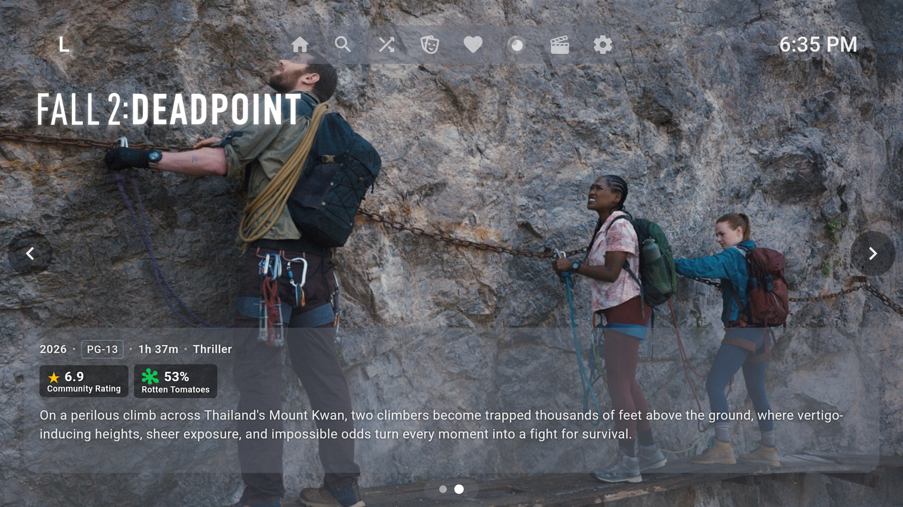
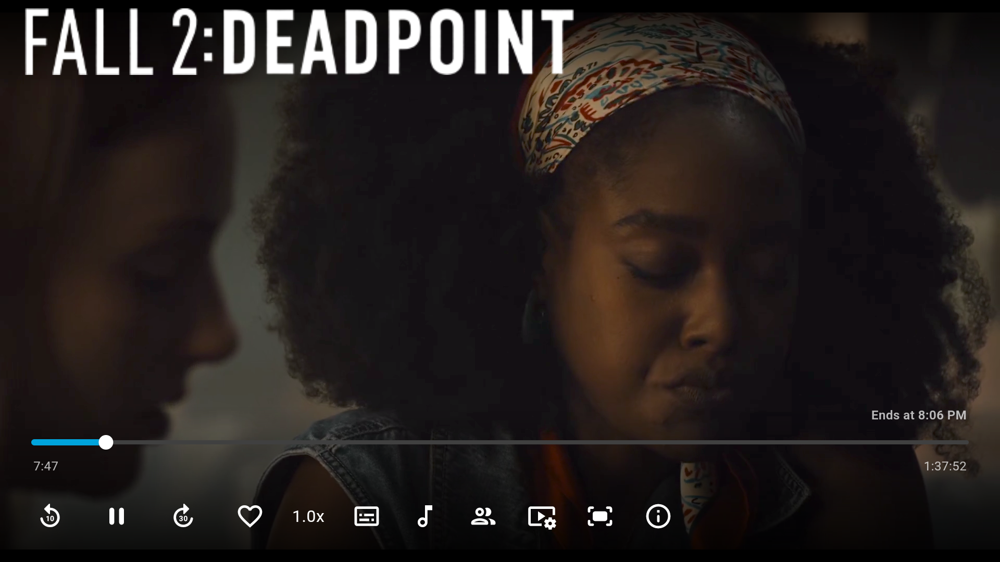
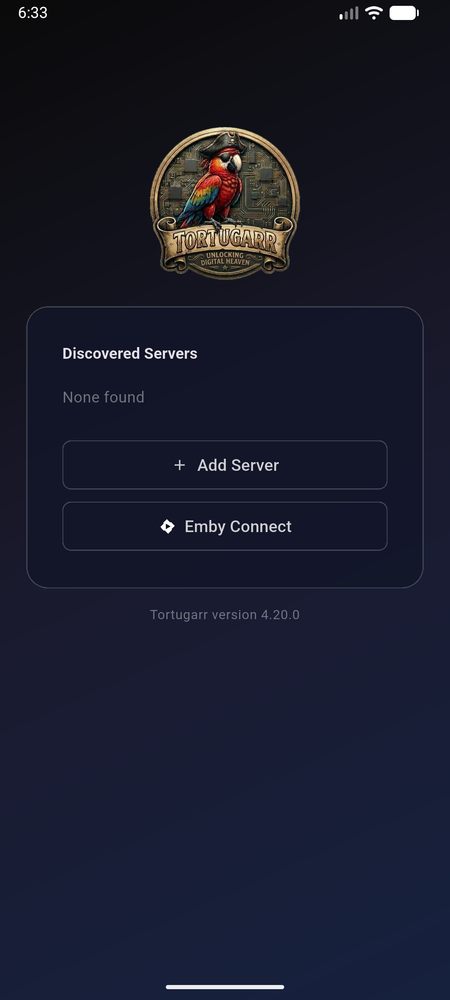

<p align="center">
  
</p>

<h1 align="center">Every pirate needs a harbor.</h1>

<p align="center">
  <b>Your own streaming service. On your TV. Yours forever.</b><br>
  No subscriptions. No ads. Nothing disappears because a licence ran out.
</p>

<p align="center">
  <a href="#get-started-in-about-15-minutes"><b>Get started</b></a> ·
  <a href="https://github.com/tortugarr/tortugarr/releases/latest"><b>Download</b></a> ·
  <a href="docs/FAQ.md"><b>FAQ</b></a> ·
  <a href="server/docs/troubleshooting.md"><b>Troubleshooting</b></a> ·
  <a href="#take-it-further-"><b>Build on it</b></a>
</p>

<p align="center">
  
</p>

---

## Five subscriptions, and still nothing to watch?

Shows vanish. Prices go up. The film you wanted is "not available in your region".

**Tortugarr turns a spare PC into your own streaming service.** It looks and feels like the
big apps, it runs on your TV with the normal remote, and everything you add stays.

## From the sofa, in three clicks

1. **Browse** what is trending, popular and coming soon, right on the TV.
2. **Pick** *Download Now*, and choose the exact file: quality, size, how many share it.
3. **Watch.** It lands in your library on its own, with subtitles.

No laptop. No copying files around. No fiddling with five web pages.

<p align="center">
  <br>
  <sub><b>Download Now</b>: every release, sorted by quality, with size and seeders. You pick; it does the rest.</sub>
</p>

## Why people keep it

- 🛋️ **Made for the remote.** Every feature works from the sofa, on Android TV and Google TV.
- 🎯 **You choose the file.** No black box: see every release, its quality and size, and pick.
- 🛡️ **Fakes stay out.** Cinema recordings, fake releases and hidden `.exe` files are filtered
  and blocked before they reach your library.
- 📺 **Series that complete themselves.** See exactly which episodes you are missing, grab one,
  a whole season, or let a season follow itself as new episodes air.
- 💬 **Subtitles included.** Fetched automatically by your server. Missing one? Find it from
  the TV.
- 🧹 **Cleans up after itself.** Delete from the TV and the file, the download and the request
  all go. Running low on space? It tells you what is safe to remove.
- 🔒 **Nothing phones home.** The app talks to your server and nothing else. No account with
  us, no tracking. The app itself holds no keys or passwords.
- 📱 **TV, phone and tablet.** Same library everywhere; start on the phone, finish on the TV.

<p align="center">
  <br>
  <sub>Film series at a glance: the parts you have, the ones you are <b>missing</b> (one click to get them), and what is <b>coming</b>.</sub>
</p>

<p align="center">
  
  &nbsp;
  
</p>

## One command sets up the whole harbor

A few questions with sensible defaults, then the installer sets up and connects everything:
Jellyfin, Seerr, Sonarr, Radarr, Prowlarr, Bazarr, the download client and the Tortugarr
plugin. About ten minutes later you type a short code from the TV into your phone, and you are in.

## Get started in about 15 minutes

Everything you need is on the **[Releases page](https://github.com/tortugarr/tortugarr/releases/latest)**:

| File | For |
|---|---|
| `tortugarr-server-4.20.0.tar` | The server: installer + Tortugarr plugin, ready to run |
| `tortugarr-tv-4.20.0.apk` | The app for Android TV / Google TV |
| `tortugarr-phone-4.20.0.apk` | The app for Android phones and tablets |

**Before you start, you need:**
- A PC or server with **Linux**: Ubuntu 22.04 or 24.04 (64-bit). Other Debian-based systems
  usually work but are not tested.
- **4 GB RAM**, about **5 GB** for the software, and room for your movies and series.
- Your own indexers (and, if you want, a usenet provider or a VPN subscription).
- Windows? It is not supported, but you can run the installer inside WSL2. See
  [Windows and WSL2](server/docs/install.md#requirements) in the install guide first.

### 1. Install the server

Open a terminal on the machine that will be your server and run:

```bash
wget https://github.com/tortugarr/tortugarr/releases/latest/download/tortugarr-server-4.20.0.tar
tar -xf tortugarr-server-4.20.0.tar
cd tortugarr-server
sudo ./install.sh
```

Answer the questions (pressing Enter takes the default), and choose the username and password
you will log in with everywhere. Docker is installed for you if it is missing. At the end the
installer prints the addresses of everything it set up.

- Every question and option explained: the [**install guide**](server/docs/install.md).
- Which ports it uses and how the pieces connect: [**architecture**](server/docs/architecture.md).
- Something not right? Run `sudo tortugarr doctor`, then see
  [**troubleshooting**](server/docs/troubleshooting.md).

### 2. Add your indexers

Open Prowlarr at `http://<server-address>:9696` and add the indexers you want under
**Indexers > Add Indexer**. They are passed on to the rest automatically. This is the one thing
Tortugarr cannot do for you.

### 3. Put the app on your TV

The TV needs to allow apps from outside the Play Store:

1. On the TV, install **Downloader** (by AFTVnews) from the Play Store.
2. Allow it to install apps: **Settings > Apps > Security & restrictions > Unknown sources >
   Downloader**.
3. Open Downloader, type the address of `tortugarr-tv-4.20.0.apk` from the Releases page, and
   install it.

Other ways work too: a USB stick with the APK, or `adb install tortugarr-tv-4.20.0.apk`.

### 4. Put the app on your phone (optional)

Open the Releases page on the phone, tap `tortugarr-phone-4.20.0.apk`, and allow your browser
to install apps when Android asks.

### 5. Connect

Open Tortugarr, add your server (`http://<server-address>:8096`) and choose **Quick Connect**.
The TV shows a six-digit code. On your phone, open the same address in a browser, log in, tap
the profile icon > **Quick Connect**, and type the code. Done.

### Changed your mind? Uninstall

On the server:

```bash
sudo tortugarr uninstall
```

It lists what it will remove and asks before it does anything:

- **Your movies and series are never touched.** Everything in the data folder
  (`/srv/tortugarr` by default) stays exactly where it is.
- **Settings and passwords:** keep them (a reinstall picks up where you left off) or delete them.
- **A backup first:** offered by default, so you can always come back.
- **Docker and the downloaded images:** removed only if you say so, and Docker only if
  Tortugarr installed it.
- **On Windows with WSL2:** the port forwarding, firewall rules and keep-alive task are removed
  too, and the network is set back the way it was.

On the TV or phone, remove the app like any other: **Settings > Apps > Tortugarr > Uninstall**.

<details>
<summary><b>For developers: build from source</b></summary>

```bash
git clone https://github.com/tortugarr/tortugarr.git
cd tortugarr
```

You need these installed first (setting them up is up to you):

| To build | You need |
|---|---|
| The **app** (TV and phone APK) | [Flutter](https://flutter.dev) 3.44 (stable) with the Android SDK, and a JDK 17 or newer |
| The **server plugin** | The [.NET 10 SDK](https://dotnet.microsoft.com) |

App:

```bash
cd app
cp lib/data/services/download/download_now_secrets.example.dart \
   lib/data/services/download/download_now_secrets.dart
flutter pub get
flutter build apk --release --flavor androidTv-public --dart-define=TORTUGARR_PUBLIC=true   # TV
flutter build apk --release --flavor mobile-public    --dart-define=TORTUGARR_PUBLIC=true   # phone
```

The APKs land in `app/build/app/outputs/flutter-apk/`. Without your own signing key
(`android/app/release.keystore`) they are signed with the debug key, which is fine for
sideloading.

- Server: build the plugin and make the tar file as described in
  [`server/README.md`](server/README.md). A plain clone is not enough to install: the built
  plugin is not kept in git.

</details>

## Help and documentation

| | |
|---|---|
| ❓ [**FAQ**](docs/FAQ.md) | Answers to the questions people actually ask: downloading, series, subtitles, the remote, disk space. |
| 🧰 [**Install guide**](server/docs/install.md) | Everything the installer does, every question it asks, and how to manage the server afterwards (`sudo tortugarr`). |
| 🩺 [**Troubleshooting**](server/docs/troubleshooting.md) | Symptoms, causes and fixes when something on the server is not right. |
| 📺 [**The app**](server/docs/app.md) | Connecting the app to your server, and how app and server versions belong together. |
| 🏗️ [**Architecture**](server/docs/architecture.md) | How the pieces fit, which ports are used, and the security notes. |
| 🔌 [**Plugin API**](server/docs/design/tortugarr-plugin-api.md) | The contract between the app and the Tortugarr plugin, for developers. |
| ⚖️ [**Disclaimer**](server/DISCLAIMER.md) | What Tortugarr is and is not responsible for. |

## Tested on

| | |
|---|---|
| **Server** | Ubuntu 24.04.5 LTS. Windows 11 with WSL2 works with an optional helper (not officially supported). |
| **App** | Android TV and Google TV (real TV and emulator). Android phones: first runs in an emulator. |
| **Version** | 4.20.0 |

## What is in this repository

| Folder | |
|---|---|
| [`app/`](app/) | The Tortugarr app, built on [Moonfin](https://github.com/Moonfin-Client/Moonfin-Core). |
| [`server/`](server/) | The installer and the Tortugarr Jellyfin plugin. |
| [`docs/`](docs/) | [FAQ](docs/FAQ.md), user guide and manual. |

## Take it further 🏴‍☠️

Tortugarr was built by one person and an AI, for one living room. If it is useful to you, it can
be so much more, and **you are warmly invited to build on it**:

- **Fork it** and make it yours. That is what the licence is for.
- **More screens:** the app is built on Moonfin, which already runs on iPhone, Apple TV, desktop
  and web. Tortugarr only ships Android today; bring the Tortugarr features to the rest.
- **More homes:** other Linux distributions, ARM boards like the Raspberry Pi, a NAS.
- **More people:** per-user permissions, profiles for the kids, more languages.
- **Better ideas than ours:** open an issue, send a pull request, or just tell us what you
  would change.

Every pirate ship started as somebody else's boat.

## Free, and it stays free

Open source under GPL-2.0. Use it, change it, share it. See [LICENSE](LICENSE).

> Tortugarr ships software only: no content, no indexers and no accounts. You decide what you
> add, and you are responsible for using it legally where you live.
